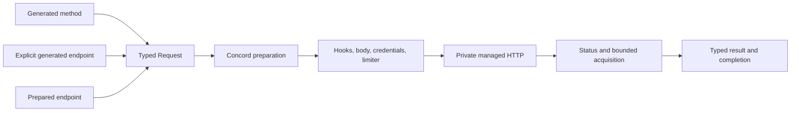

# Concord

Concord generates strongly typed asynchronous HTTP API clients from a compact Rust macro. Application code works with generated builders, endpoint methods, typed bodies, typed responses, pagination terminals, and explicit errors. The `concord` package is the user façade over the compiler and managed runtime; its core owns finite request and response handling, hooks, authentication, rate limiting, managed HTTP, status classification, cancellation, completion, and redaction.

Use Concord when an API client should feel like ordinary Rust but needs stronger structure and lifecycle guarantees than ad-hoc request construction.

## Quick start

Add the user-facing package:

```toml
[dependencies]
concord = { version = "0.1.0", features = ["json"] }
serde = { version = "1", features = ["derive"] }
tokio = { version = "1", features = ["macros", "rt-multi-thread"] }
```

Define a client and await a typed request:

```rust
use concord::{Json, api};
use serde::Deserialize;

#[derive(Deserialize)]
struct User {
    id: u64,
    name: String,
}

api! {
    client UsersApi {
        base "https://api.example.com/";
    }

    GET User(name: String) -> Json<User> {
        path ["users", ep.name];
    }
}

#[tokio::main]
async fn main() -> Result<(), Box<dyn std::error::Error>> {
    let client = UsersApi::builder().build()?;

    let user = client.user("alice".to_owned()).await?;
    println!("{}: {}", user.id, user.name);

    let response = client.user("bob".to_owned()).response().await?;
    println!("status={} endpoint={}", response.status(), response.metadata().endpoint());

    Ok(())
}
```

## What Concord provides

- Generated clients, scopes, endpoint values, builders, and capability-specific methods.
- Host, path, query, header, timeout, authentication, pagination, and lexical rate-limit composition.
- Bytes, text, JSON, streaming bodies and responses, multipart requests, CSV, NDJSON, and custom record decoding.
- API keys, bearer tokens, Basic credentials, OAuth2 client credentials, endpoint-backed credentials, and custom providers.
- Offset, page-number, cursor, and application-defined pagination controllers.
- Process-local rate limiting, custom limiters, observers, and prepared explicit keys.
- Prepared runtime-defined endpoints that still use the same managed executor.
- Bounded status bodies, safe error categories, deterministic completion, and redaction-aware hooks.
- Advanced request/response specifications that extend the runtime without exposing native HTTP objects.

## One managed lifecycle



Generated, explicit, and prepared endpoints all converge on the same request family. Extensions receive semantic values through public traits; native Reqwest requests and responses remain private.

## Documentation

- [Documentation home](docs/README.md)
- [Getting started](docs/getting-started.md)
- [Basic usage](docs/basic/README.md)
- [Advanced and extensible usage](docs/advanced/README.md)
- [Practical guides](docs/guides/README.md)
- [Concepts and design](docs/concepts/README.md)
- [Reference](docs/reference/README.md)
- [Developer documentation](docs/developer/README.md)

The manual is deliberately compact: section directories contain several substantial Markdown pages rather than one directory per page.

## Product boundaries

Concord does not expose native Reqwest request or response values to ordinary extensions and does not provide a second transport or executor. It also does not provide prepared pagination, parallel page fetching, partial pagination results, unbounded body or stream modes, WebSockets, an SSE reconnection framework, multipart response parsing, or distributed strict quota enforcement.

See [Features, limits, errors, and compatibility](docs/reference/features-limits-and-errors.md) and [security, bounds, and limitations](docs/concepts/security-bounds-and-limitations.md) for exact alternatives and constraints.

## Workspace layout

```text
concord/               User façade and generated public integration tests
concord_core/          Semantic runtime kernel and lifecycle proofs
concord_extras/        Downstream implementations of public semantic contracts
concord_macros/        Declaration compiler and Cargo fixtures
concord_examples/      Compile-checked runnable examples
concord_test_support/  Shared deterministic test infrastructure
perf/                  Local operation-exact benchmark probes
docs/                  User, advanced, reference, concept, and contributor manual
scripts/               Portable repository checks
```

`concord_test_support`, the standalone fixture workspace, `dangerous-dev-tools`, and `perf/` are retained because they execute shared deterministic, feature-isolation, compatibility, and benchmark checks. They are not ordinary application APIs.

## Contributor commands

```text
just fmt
just check
just test
just test-all
just lint
just docs
just examples
just features
just bench
just verify
```
