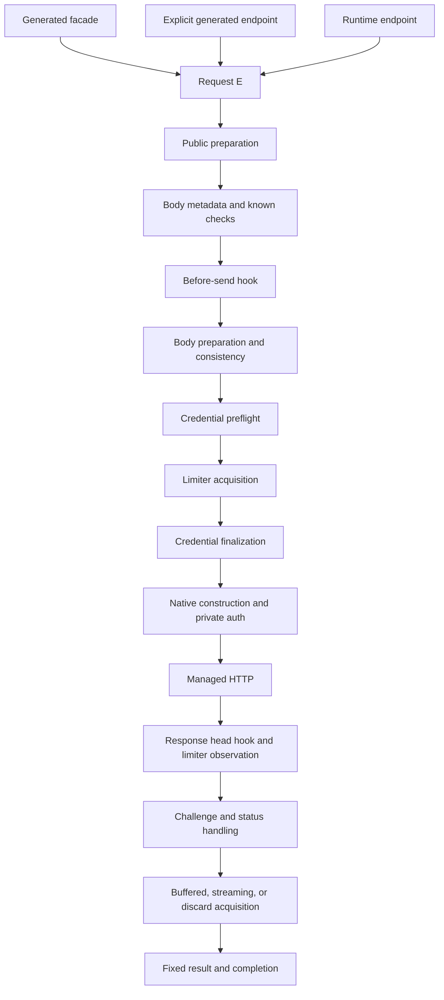
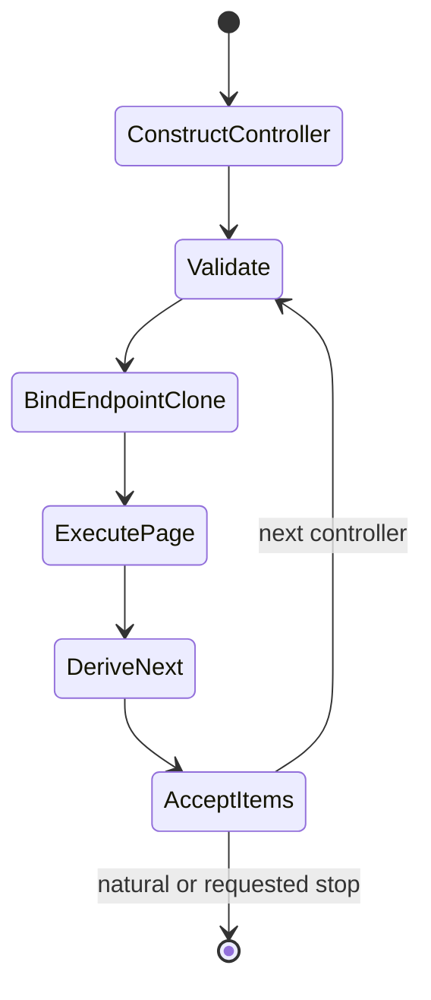
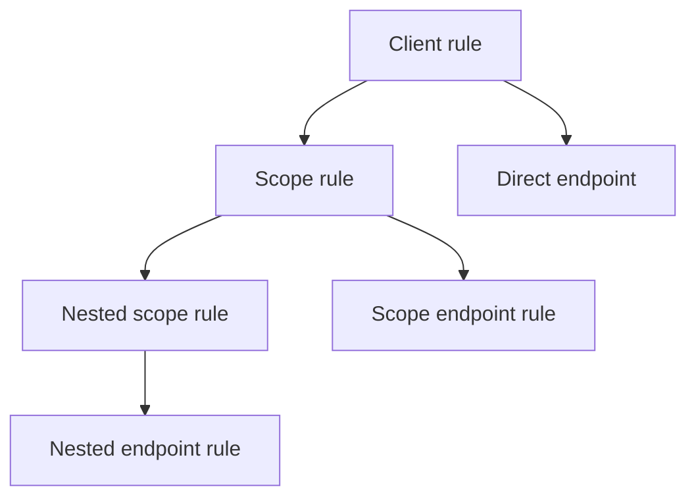

# Design, code generation, and the managed lifecycle

> Audience: Anyone evaluating or extending Concord

These concepts explain why Concord generates contract-shaped Rust APIs and centralizes difficult behavior in one bounded execution lifecycle.

## Vision

Concord's goal is to make a remote HTTP API feel like a reviewed Rust interface without turning the application into an HTTP framework maintainer.

### Contract-shaped client code

The API declaration should resemble the remote contract: named clients, scopes, endpoint parameters, request shapes, successful responses, authentication placement, pagination state, and lexical quotas. Generated Rust then provides normal types and methods that are checked by the compiler.

### One place for difficult behavior

Authentication, retry containment, deadlines, body replayability, finite limits, status handling, response streaming, pagination, limiter ordering, completion, and redaction interact in ways that are easy to get subtly wrong. Concord centralizes those interactions in one runtime rather than asking every endpoint or extension to reproduce them.

### Finite ordinary behavior

An API client should not accidentally create an unbounded body collector, status-body buffer, page loop, record staging buffer, limiter map, or cooldown table. Concord's ordinary paths require positive finite bounds and reject first excess before exposing partial semantic output.

### Extensibility without native escape

Applications still need custom formats, credentials, paging rules, quotas, and observation. Concord exposes semantic extension traits that fit inside the runtime. This retains type flexibility while keeping native request/response ownership private.

### Explainable limitations

A smaller, coherent product is preferable to a nominally universal HTTP abstraction. Concord deliberately excludes custom transports, native response access, distributed quota semantics, prepared pagination, WebSocket orchestration, and several speculative modes. Where an advanced alternative exists, the documentation names it.

### Normal Rust over runtime magic

Generated clients remain ordinary Rust. Application-defined codecs and controllers are ordinary types. Feature-disabled types fail at compile time. No runtime schema registry or dynamic type-erased response path is required.

## Why code generation

The `api!` macro converts a compact structural declaration into a statically typed public client.

### What generation buys

- Endpoint parameters become Rust constructor and method arguments.
- Body input and response output are selected through traits.
- Optional capability methods appear only where valid.
- Scope values and endpoint values have distinct typed ownership.
- Explicit endpoint structs can be stored and passed before execution.
- Invalid DSL shapes fail near the declaration.
- Renamed dependencies resolve through package metadata.

### What the macro should own

The macro legitimately owns structural facts:

- client, scope, and endpoint names;
- fixed base URL literal;
- lexical hierarchy;
- request-shaping declarations;
- credential declarations and placement references;
- pagination field bindings;
- lexical rate-limit origins;
- generated public names and private integration.

### What the macro should not own

Semantic behavior belongs to Rust types and core:

- custom codec algorithms;
- request-body preparation;
- response acquisition mode behavior;
- record framing;
- pagination arithmetic or cursor semantics;
- rate-limit key values for advanced custom use;
- credential-provider protocols.

This is why body/response positions store arbitrary Rust types, pagination accepts an arbitrary controller type, and lexical rate limits do not inspect runtime values.

### Why not a runtime schema

A runtime schema would require dynamic endpoint lookup, erased values, late errors, and a second model of Rust types. Concord instead lets Rust's compiler check the public API.

### Generated-private boundary

The macro emits private integration through `concord::__private`, which delegates semantic execution to core and owns feature-dependent façade composition. A generated contract version prevents incompatible macro/façade/core combinations. That bridge is not a supported application extension surface.

## One managed lifecycle

Generated facade methods, explicit generated endpoints, and runtime endpoints all converge on the same runtime.

### Why ordering matters

- A known request limit can fail before a hook or body materialization.
- A hook veto must prevent body, credentials, limiter, and send work.
- Credential preflight occurs before a potentially long limiter wait.
- Exact credential finalization occurs after the wait to prevent stale material.
- Safe debug is emitted before native-only authentication materialization.
- Limiter observation sees the response head before body polling but cannot change the current result.
- Status classification happens before successful-body specifications.
- Completion observes a fixed result.

### Attempts and recovery

One Concord attempt includes one hook/body/auth/limiter/native lifecycle. Reqwest-native retries stay inside that attempt. Authentication recovery creates at most one additional Concord attempt with the same operation identity and deadline.

### Streaming result fixation

A streaming response is successful when the bounded stream is opened. The completion outcome is `StreamOpened`. Consumption is later application work, and item errors do not rewind the endpoint result.

### Pagination

Pagination wraps the same ordinary request lifecycle for each page. It does not own another HTTP executor. Page completions are ordinary request completions; aggregate completion is separate.

## Pagination state machine

Pagination uses one typed controller model for built-in and application-defined state.

### Ownership

- The original endpoint snapshot owns stable request configuration.
- Controller construction reads each bound request-local field once.
- The controller is the sole authority for evolving state.
- Every page uses a fresh endpoint clone.
- Bound controller fields are written into that clone before ordinary preparation.
- Endpoint changes are never copied back implicitly.

### Termination

`next` determines whether another state exists. `short_page_size` optionally adds count-based natural termination. There is no universal empty-page rule and no special runtime privilege for built-in controllers.

### Page lifecycle

Each page receives:

- a child operation ID;
- page index;
- fresh deadline;
- ordinary hooks/auth/limiter/HTTP/status/response/completion.

Authentication recovery stays within one page. The changing page index is context metadata, not a generated rate-limit key.

### Safety

Canonical structural identity catches repeated requests before a repeated send. Page/item/identity ceilings remain finite. Results are all-or-error.

### Why no streaming pagination

A direct vector result keeps controller transition, page side effects, finite ceilings, and aggregate completion explicit. A page/item stream would require a different result, cancellation, partial-success, and completion contract and is not part of the current product.

## Lexical rate limits

Generated rate limits follow the API tree instead of runtime values.

An endpoint's plan is the ordered list of declarations on its lexical path.

### Identity and key

Each declaration gets one deterministic identity based on the generated module/client/scope/endpoint declaration path. The generated key is global. The governor bucket therefore distinguishes declarations through rule identity, not argument values.

### Why values are excluded

Dynamic generated keys would:

- impose `Display` bounds on unrelated endpoint parameters;
- copy request values into limiter plans;
- expand redaction requirements;
- create unclear per-value semantics;
- make cross-endpoint sharing depend on string formatting.

Lexical ownership is easier to read and verify.

### Scope behavior

Different runtime values of a scope parameter share the same scope declaration bucket. Different endpoint arguments and pagination continuations share the endpoint declaration bucket. Separate declarations remain distinct.

### Advanced escape

Runtime endpoints can append explicit `RateLimitRule` values with bounded `RateLimitKey` parts. A custom limiter can implement application-specific or distributed authority. This advanced boundary is deliberate and not re-exported into normal DSL syntax.

### Governor scope

The built-in governor is process-local, bounded, and best-effort. Client clones share it. Independent builds create independent default state. Sharing one explicit limiter `Arc` shares its namespace intentionally.

## Cargo feature model

Cargo features are additive and unified across the final dependency graph. Concord documents both API availability and isolation behavior.

### Core versus macro

`concord_core` owns runtime features. `concord_macros` parses type-shaped syntax without mirroring runtime dependencies or feature categories. A feature-disabled built-in type is simply unavailable to Rust type checking.

### Default graph

Defaults enable TLS, HTTP/2, and the process-local rate-limit governor. Data-format features remain opt-in.

### Parser isolation

- `records` has no Serde/CSV dependency.
- `csv` adds the CSV parser and Serde.
- `ndjson` adds Serde JSON but does not enable the normal endpoint `json` feature.
- macro compilation does not need Reqwest, Tokio, CSV, or Serde JSON.

### Feature unification

If any dependency enables a dangerous feature, its public surface exists for the whole compiled crate. A normal workspace all-feature test cannot prove feature absence. Standalone Cargo fixtures with `default-features = false` are required for isolation tests.

### Generated DSL

The macro does not recognize `Json`, `Multipart`, `Records`, `Csv`, or `NdJson` semantically. It generates trait bounds over the written Rust types. Feature diagnostics therefore come from type availability and focused compile tests rather than alternate macro modes.

### Compatibility

The façade and macro private bridge is protected by a generated contract version. Feature changes do not silently change that version unless the private generated integration changes.
