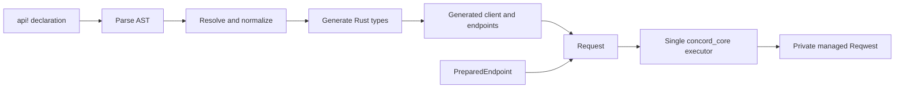
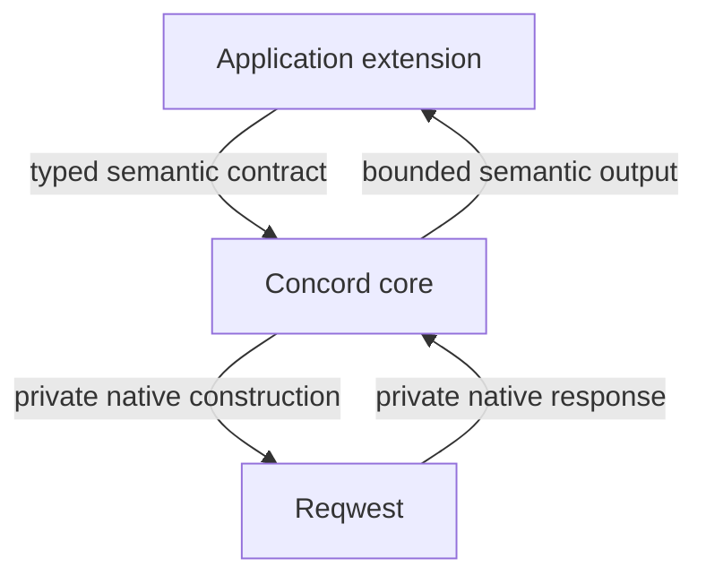
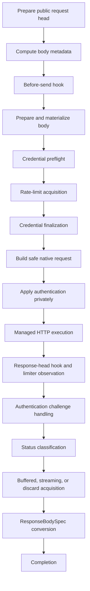

# Repository architecture and contributing

> Audience: Concord contributors

Contributor changes should preserve one production representation and one execution lifecycle. This page maps the repository, macro pipeline, core runtime, generated compatibility bridge, and extension design process.

## Repository layout

The workspace uses Cargo resolver 3, Rust edition 2024, and Rust 1.85 as its minimum supported compiler.

```text
concord_core/          Public runtime, managed execution, extensions, and errors
concord_macros/        `api!` parser, semantic resolution, and generated code
concord_test_support/  Deterministic local servers, gates, TLS, and fixture helpers
concord_examples/      Runnable public examples and construction checks
perf/                  Operation-exact benchmark smoke suite
docs/                  User, concepts, reference, and developer documentation
scripts/               Small repository validation helpers
```

### `concord_core`

Important areas:

```text
src/auth/          Credential material, providers, slots, placement, recovery
src/body/          Managed request bodies, specifications, streams, multipart
src/codec/         Buffered encode/decode contracts and built-ins
src/execute/       The single production execution pipeline
src/hooks/         Before-send, response-head, completion, and debug contracts
src/http/          Managed clients, configuration, proxy, provider HTTP
src/pagination/    Typed controller loop, identities, limits, pending request
src/rate_limit/    Plans, custom limiter contract, bounded default governor
src/records/       Incremental record decoding, CSV, NDJSON, batching
src/request/       Request family, preparation, endpoint and prepared contracts
src/response/      Body specifications, acquisition modes, metadata, ByteStream
src/runtime/       Immutable resolved runtime configuration
```

Public exports are intentionally concentrated in:

- `src/prelude.rs` for common application types;
- `src/advanced.rs` for stable extension contracts;
- `src/dangerous.rs` for explicitly gated reduced-safety APIs.

`src/__private.rs` is generated integration. `src/__development.rs` exists only under `dangerous-dev-tools` for internal benchmarks and probes.

### `concord_macros`

```text
src/ast.rs         Parsed source representation
src/parse.rs       Syntax parsing and source-focused diagnostics
src/model.rs       Resolved, normalized semantic model
src/resolve.rs     Names, references, inheritance, capabilities, validation
src/codegen.rs     Generated clients, endpoints, bindings, docs, contract marker
src/crate_path.rs  Caller-visible `concord_core` dependency resolution
src/names.rs       Deterministic generated naming helpers
```

The macro owns syntax and structural generation. Semantic body and response behavior belongs to Rust trait selection in `concord_core`, not to name matching in the macro.

### Tests and fixtures

- Ordinary unit and integration tests live beside or under their owning crate.
- Compile-fail source diagnostics use Trybuild under `tests/ui/fail`.
- Standalone Cargo fixtures exist only when package metadata or dependency topology matters.
- Real HTTP behavior uses local deterministic servers. External services are not part of the test contract.

See [Testing strategy](testing-and-tooling.md#testing-strategy).

### Files that should not reappear

The user-friendly tree intentionally excludes retired internal governance material, generated audit workspaces, accepted temporary output, and empty fixture directories. Git history remains the archive for earlier internal workflows.

## Architecture overview

Concord has two major halves:

1. `concord_macros` turns an API declaration into typed Rust client and endpoint structures.
2. `concord_core` executes all generated, explicit, and prepared requests through one managed lifecycle.



The diagram is architectural, not a promise that generated-private names are stable.

### Structural ownership

The macro owns facts visible directly in the declaration:

- clients, scopes, and endpoints;
- parameter names and types;
- host, path, query, and header expressions;
- pagination bindings;
- lexical rate-limit declarations;
- generated names and conditional method availability.

The runtime owns semantic behavior:

- request-body metadata and materialization;
- response acquisition and conversion;
- credentials and authentication placement;
- limiter acquisition and observation;
- deadlines and cancellation;
- native HTTP ownership;
- finite limits;
- status classification;
- completion and redaction.

### One request family

Generated endpoint methods, explicit generated endpoint values, and prepared endpoints all become the same public `Request<E>` family. Capability wrappers such as `ResponseRequest<E>`, pagination, and dangerous raw response are typed terminals over that family rather than separate transports.

### One response acquisition model

Every response specification selects one sealed mode:

```text
Buffered  -> complete bounded Bytes
Streaming -> bounded lazy ByteStream
Discard   -> no body poll
```

Applications can define `ResponseBodySpec`, but cannot define a fourth native or unbounded mode.

### Extension boundary



Extension code receives the values explicitly documented by its trait. It does not receive native requests, native responses, credential slots, governor maps, executor plans, or transport handles.

### Invariants for contributors

A proposed change should be rejected or redesigned when it:

- creates another request or response representation that can execute independently;
- exposes Reqwest to ordinary extensions;
- adds an application-defined acquisition mode;
- reconstructs a semantic choice in both macro and core;
- makes a finite path unbounded;
- holds a core lock across `.await`;
- invokes application code under a core lock;
- uses detached cleanup to preserve correctness;
- bypasses status handling, deadlines, completion, or redaction.

### Related pages

- [Core runtime](architecture-and-contributing.md#core-runtime)
- [Macro pipeline](architecture-and-contributing.md#macro-pipeline)
- [Generated contract](architecture-and-contributing.md#generated-contract)
- [One managed lifecycle](../concepts/design-and-lifecycle.md#one-managed-lifecycle)

## Core runtime

`concord_core/src/execute/mod.rs` owns the production execution path. `Request<E>` and `.response()` implement `IntoFuture` by entering this module.

### Direct request lifecycle



The exact implementation may interleave private bookkeeping, but the security-sensitive ordering must remain observable as shown.

### Request preparation

Preparation resolves the typed endpoint into:

- logical URL and sanitized URL;
- public headers;
- timeout and operation metadata;
- authentication plan;
- immutable lexical rate-limit plan;
- request-body metadata;
- endpoint response specification.

Preparation failures still emit the appropriate completion result without constructing a native request.

### Body timing

`RequestBodySpec::metadata` runs before the before-send hook and must not perform expensive materialization. The hook can veto the operation before `prepare` runs. Core then checks that the produced `RequestBody` is consistent with its metadata.

Replayability is derived from the managed body form. Application code cannot declare a one-shot stream replayable.

### Credentials and limiting

Credential preflight may acquire or refresh safe material before waiting. Exact-version finalization occurs after rate-limit acquisition so stale credential work cannot be silently applied after a long wait.

Authentication recovery is bounded to one recovery attempt. It retains the operation deadline and identity, and reacquires the limiter through the same attempt lifecycle.

### Native boundary

The logical request remains free of authentication material. Native authentication placement occurs immediately before managed execution and is not returned to hooks, public debug output, generated docs, or completion events.

### Responses

After successful status classification, core owns the selected sealed acquisition mode:

- buffered collection with complete-only output;
- lazy `ByteStream` opening;
- discard without polling.

Known length can fail before polling. Unknown first excess is withheld. Streaming and record errors after opening are stream items and do not emit another endpoint completion event.

### Completion

Completion is fixed by the endpoint operation:

- `Success` for completed buffered/discard output;
- `StreamOpened` once a stream is returned;
- a categorized failure when the operation fails before output fixation.

Dropping a stream cancels by ownership. There is no detached task that must finish for correctness.

### Pagination

Pagination uses the same executor once per page. Each page gets:

- a fresh endpoint snapshot;
- a child operation ID;
- a page-local deadline;
- ordinary authentication and limiting;
- ordinary response decoding and completion.

The aggregate operation owns collection and aggregate completion. It never introduces a second page transport.

### Test expectations

Changes to the runtime should include deterministic tests for:

- exact ordering and side-effect cutoffs;
- earliest error precedence;
- finite first-excess behavior;
- cancellation ownership;
- recovery boundaries;
- safe diagnostics;
- feature-disabled behavior;
- unchanged completion count.

## Macro pipeline

The `api!` entry point is intentionally small:

```text
parse tokens
→ resolve and normalize
→ resolve caller-visible concord_core path
→ generate Rust tokens
```

### Parse stage

`parse.rs` reads the surface grammar into `ast.rs` structures and emits focused source diagnostics. This stage should reject malformed or unsupported syntax without making runtime decisions.

Examples of structural facts owned here:

- an endpoint has a method, name, parameters, and response type;
- a body parameter appears in the body position;
- a pagination declaration contains a controller type and field initializers;
- a rate-limit block contains cost and windows;
- declarations are unique where the grammar requires uniqueness.

### Resolve stage

`resolve.rs` and `model.rs` perform semantic normalization that is still knowable at generation time:

- name uniqueness and generated-name collisions;
- variable, scope, and endpoint references;
- host/path/query/header source resolution;
- pagination bind destinations;
- lexical rate-limit ancestry and declaration identity;
- capability availability;
- feature-focused diagnostics where the type is unavailable.

The resolved model should eliminate inheritance operations. Code generation should receive the final ordered plan rather than interpret replace/off/template operations at runtime.

### Code generation

`codegen.rs` emits:

- client builders and facades;
- scope builders and snapshots;
- endpoint structs and constructors;
- request creation methods;
- typed pagination integration;
- lexical rate-limit plans;
- conditional terminals;
- generated Rustdoc;
- the generated contract compatibility assertion.

Generated body and response semantics are type-neutral. The model stores Rust types, and generated bounds select `RequestBodySpec`, `ResponseBodySpec`, and `PageResponseSpec`. The macro must not branch on names such as `Json`, `Bytes`, `Records`, or an application-defined specification.

### Dependency resolution

`crate_path.rs` discovers the caller-visible alias for the `concord_core` package. Generated code must work when users rename the dependency in `Cargo.toml`.

Standalone fixtures cover:

- renamed façade dependency;
- missing core dependency;
- generated contract mismatch;
- feature-disabled JSON, OAuth2, multipart, and governor behavior.

### Diagnostic design

A diagnostic should:

- point to the smallest relevant source span;
- name the structural problem;
- suggest the supported syntax when a removed form has a clear replacement;
- allow ordinary Rust checking to report inaccessible, missing, unknown, or type-incompatible struct fields;
- avoid downstream implementation details.

### Adding syntax safely

Before adding grammar, decide:

1. Is the fact truly structural and visible in the declaration?
2. Can ordinary Rust traits represent the semantic choice instead?
3. Does the generated model need a new independent runtime path?
4. Can an application-defined equivalent work without another macro branch?

Prefer type-shaped syntax and stable trait selection over enumerating built-in categories.

## Generated contract

The façade bridge and `concord_macros` currently share generated contract version **16**.

The marker protects the private interface used by generated code. It is not the package version and is not a public capability number.

### Why it exists

Generated code references doc-hidden integration traits, constructors, and bridge methods in `concord_core::__private`. A macro/core mismatch could otherwise compile far enough to fail with confusing downstream errors or, worse, call an incompatible private contract.

Both sides assert the same integer at compile time:

```text
concord_core/src/generated_contract.rs
concord_macros/src/codegen.rs
```

### When to bump it

Bump the generated contract when a change makes generated code incompatible with an older core or makes an older macro incompatible with the new core. Examples include:

- changing a generated-private trait signature;
- adding a required associated type;
- replacing a generated bridge method;
- changing how generated endpoint capability integration is represented.

Do **not** bump it for:

- implementation-only runtime changes;
- new tests;
- documentation changes;
- compatible public API additions that generated code does not use;
- code-generation fixes that keep the same private interface.

### Required update surface

A bump must update together:

- core constant;
- macro constant;
- exact version tests;
- mismatch fixture;
- downstream generated fixtures;
- relevant manual and compatibility documentation.

### Testing

The `contract_mismatch` fixture supplies an intentionally incompatible fake core and must fail with the focused generated-contract diagnostic. Normal and renamed-façade fixtures must continue to compile.

### Public compatibility

Users should version `concord_core` and `concord_macros` together. The private contract marker catches mismatches, but it is not a substitute for compatible package versioning.

## Adding an extension

Concord supports application extensions through stable semantic traits. Adding a built-in should normally reuse the same contract available to downstream applications.

### Choose the right extension seam

| Need | Contract |
|---|---|
| Complete request value to bytes | `EncodeBody` |
| Complete bytes to response value | `DecodeBody` |
| Custom managed outgoing body | `RequestBodySpec` |
| Custom buffered, streaming, or discard response | `ResponseBodySpec` |
| Framed typed record stream | `RecordDecoder` |
| Credential acquisition or refresh | `CredentialProvider` |
| Provider-side bounded HTTP | `ProviderHttp` |
| Pagination state machine | `PaginationController` |
| Application-defined quota system | `RateLimiter` |
| Default-governor response observation | `RateLimitObserver` |
| Lifecycle observation | `RuntimeHooks` |
| Runtime-defined endpoint | `PreparedEndpoint` |

### Design process

#### 1. Identify semantic ownership

Write down:

- the input the extension legitimately needs;
- the output it must produce;
- the point in the managed lifecycle where it runs;
- which limits and deadlines remain core-owned;
- what data is sensitive;
- whether it can run more than once.

#### 2. Reuse the managed lifecycle

A new built-in must delegate to the same trait and executor as a downstream implementation. Do not add a private fast path that has weaker limits or ordering.

#### 3. Keep native values private

Do not expose Reqwest request, response, client, URL, body, retry context, or transport state. Convert native state to the smallest semantic public value required by the extension.

#### 4. Keep acquisition bounded

A new response representation must select `Buffered`, `Streaming`, or `Discard`. A new record protocol should layer over `ByteStream` through `RecordDecoder` rather than add another response executor.

#### 5. Preserve feature isolation

Optional parsers and protocols should use non-default exact dependencies. The macro should not depend on implementation crates merely to recognize a type name.

#### 6. Document responsibilities

Advanced extension docs must state:

- callback timing;
- Send/Sync/static bounds;
- error behavior;
- logging and storage responsibility;
- cancellation behavior;
- feature requirements;
- what core still guarantees;
- what Concord cannot sanitize once intentionally delivered to the extension.

### Required proof

A stable extension normally needs:

- public-only downstream compile proof;
- public-only runtime proof where applicable;
- no private import audit;
- feature-disabled proof;
- no-default proof when the base trait is available there;
- redaction and safe-error tests;
- Rustdoc privacy proof;
- lifecycle and cancellation tests;
- an advanced manual page and complete example.

### When a public API is not justified

Do not add a public hierarchy merely to reuse current branches. Prefer a private adapter when it delegates to an existing public semantic contract and cannot execute independently.
