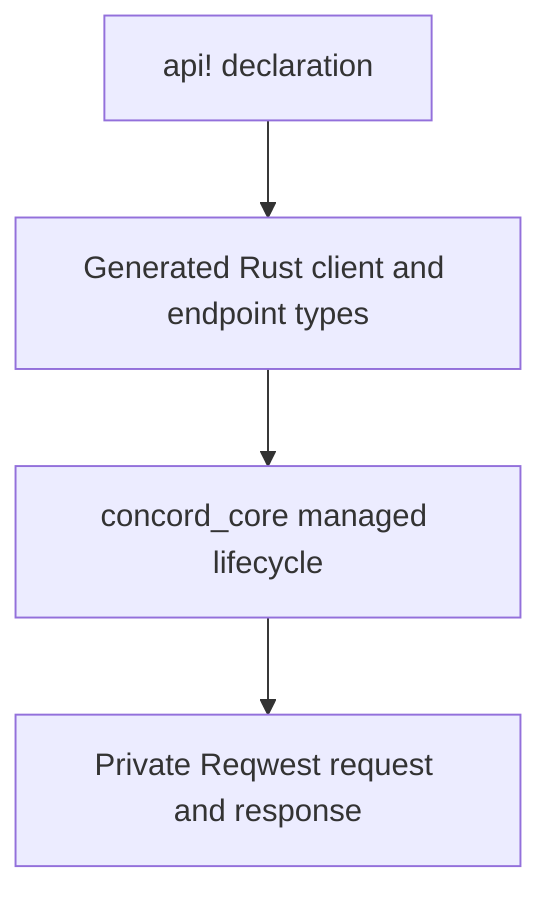

# Getting started

> Audience: New users  
> Start here: installation, first client, first request, and the runtime mental model

This page takes a new project from dependency setup to its first generated request. It also establishes the ownership and lifecycle rules that make the rest of the manual easier to understand.

## Installation

### Prerequisites

Concord uses Rust 2024 and declares Rust 1.85 as its minimum supported version. Generated requests are asynchronous and run on Tokio.

Use the `concord` façade so its runtime, macro compiler, and selected extras stay synchronized.

```toml
[dependencies]
concord = {
    path = "../concord/concord",
    default-features = false,
    features = ["default-tls", "http2", "json", "rate-limit-governor"]
}
serde = { version = "1", features = ["derive"] }
tokio = { version = "1", features = ["macros", "rt-multi-thread"] }
```

### Choosing features

Default façade features are `default-tls`, `http2`, and
`rate-limit-governor`. The façade forwards transport features to core and
installs the extras-owned governor; add only what the client uses:

- `json` for the extras-owned `Json<T>` codec.
- `oauth2-client` for the extras-owned OAuth2 client-credentials provider.
- `multipart` for multipart request bodies.
- `records` for the generic record-stream API.
- `csv` for typed CSV records; it enables `records`.
- `ndjson` for typed NDJSON records; it enables `records` but not the general `json` endpoint feature.
- `gzip`, `brotli`, and `deflate` for response decompression.
- dangerous features only after reading their dedicated pages.

A minimal HTTP client can compile with no default features, but TLS and HTTP/2 are then unavailable unless explicitly enabled.

### Tooling used by this repository

Normal development expects:

```text
rustfmt
clippy
cargo-nextest
cargo-deny
just
```

They are not runtime dependencies. `cargo test --doc` is still used for doctests because Nextest does not execute them.

### Verify the setup

```bash
cargo check
cargo test
```

For this workspace:

```bash
just check
just test
```

### What installation does not provide

- No runtime plugin system downloads codecs or API schemas.
- Cargo features are unified for the compiled binary; enabling a dangerous feature anywhere exposes that feature's public surface to the whole binary.

### Next

Continue with [Your first API](getting-started.md#your-first-api).

## Your first API

A Concord API is declared with `concord::api!`. Each invocation declares exactly one client, and that client must be first. The client starts with one fixed absolute HTTP or HTTPS base URL; root scopes and endpoints follow its closing brace. Use separate `api!` invocations when a module needs multiple generated clients.

```rust
use concord::api;

api! {
    client NotesApi {
        base "https://notes.example.com/";
    }

    GET Note(id: u64) -> Json<Note> {
        path ["notes", ep.id];
    }
}
```

The declaration generates:

- `NotesApi` and `NotesApiBuilder`;
- an inherent method `note(id)` that returns a typed `Request<_>`;
- a public explicit endpoint type under `notes_api::endpoints`;
- a generated `notes_api::prelude` with endpoint capability traits when needed;
- private integration code that connects the endpoint to the managed runtime.

### Endpoint syntax

```rust
METHOD EndpointName(parameter: Type, ...) -> ResponseType;
```

or:

```rust
METHOD EndpointName(parameter: Type, ...) -> ResponseType {
    host [...];
    path [...];
    query { ... }
    headers { ... }
    auth ...;
    timeout ...;
    rate_limit { ... }
    paginate ControllerType { ... }
}
```

`GET`, `POST`, `PUT`, `PATCH`, `DELETE`, `HEAD`, and other standard methods are accepted. Use `METHOD("PROPFIND")` for an extension method.

An endpoint may use `as alias` to select a generated method name:

```rust
METHOD("PROPFIND") Resource(id: String) as fetch -> Text;
```

### Structural rules

- Every endpoint has parentheses, including endpoints with no parameters.
- The client is first and contains configuration only; root scopes and endpoints follow it.
- A request body, when present, is the final parameter and is named `body`.
- A bodyless endpoint can be paginated; a body-bearing endpoint cannot.
- Client and scope configuration is inherited in lexical order.
- Configuration clauses appear in the fixed order documented in the DSL reference.

### Types are Rust types

Body and response positions accept Rust types that implement the corresponding Concord contracts. The macro does not branch on application-defined type names. Built-ins such as `Json<User>`, `Text`, `Bytes`, `NoContent`, `Stream<OctetStream>`, and `Records<Csv<Row>>` are ordinary public Rust specification types.

### Next

Continue with [Your first request](getting-started.md#your-first-request).

## Your first request

Build the generated client, create a typed request, and await it:

```rust
let client = NotesApi::builder().build()?;
let note = client.note(42).await?;
```

Request construction is lazy. Building the `Request<E>` does not allocate an operation ID, run hooks, prepare a body, acquire credentials, wait for a limiter, or send HTTP. Those effects begin when the request future is polled.

### Request options

Every generated request can override the operation timeout and debug level:

```rust
use concord_core::prelude::DebugLevel;
use std::time::Duration;

let note = client
    .note(42)
    .timeout(Duration::from_secs(5))
    .debug(DebugLevel::Basic)
    .await?;
```

Available timeout operations:

- `.timeout(duration)` sets a request-local deadline.
- `.disable_timeout()` removes the generated timeout for that request.
- `.inherit_timeout()` returns to the endpoint/client timeout selection.

Debug levels are `None`, `Basic`, and `Headers`. Header output is sanitized.

### Successful metadata

Direct await returns the semantic output. `.response()` returns `ApiResponse<T>`:

```rust
let response = client.note(42).response().await?;

println!("{}", response.status());
println!("{}", response.url());
println!("page={}", response.metadata().page_index());
let note = response.into_value();
```

`ApiResponse<T>::Debug` is structural and does not format `T`.

### Errors

Requests return `ApiError`. Start with `category()` and then use category-specific accessors:

```rust
match client.note(42).await {
    Ok(note) => use_note(note),
    Err(error) if error.http_status().is_some() => {
        eprintln!("status: {:?}", error.http_status());
    }
    Err(error) => eprintln!("category: {:?}", error.category()),
}
```

Concord error formatting is deliberately value-poor. Sensitive request or response data is exposed only through explicit accessors such as the bounded terminal status body.

### Cancellation

Dropping the future cancels work owned by that operation. Concord does not spawn detached cleanup to continue a cancelled request. Completed external effects, such as a limiter reservation or a hook side effect, are not rolled back.

### Next

Read [Mental model](getting-started.md#mental-model), then [Basic usage](basic/README.md).

## Mental model

Concord has three layers.



1. **The DSL describes structure.** It declares clients, values, credentials, scopes, endpoints, request shaping, pagination bindings, and lexical rate-limit ownership.
2. **Generated Rust provides the application API.** You call normal methods, build explicit endpoint structs, and receive typed requests.
3. **Core owns execution.** All generated, explicit, and prepared endpoints use the same body, authentication, limiting, HTTP, response, and completion path.

### Configuration is fixed at client build

The generated builder resolves HTTP configuration, finite runtime limits, hooks, debug defaults, limiter selection, variables, secrets, and providers into an immutable client snapshot. Clones share that snapshot. Independently built clients have independent snapshots unless they intentionally share an `Arc` extension such as a custom limiter.

### Request values are snapshots

A generated endpoint value owns its arguments and request-shaping state. Creating a request does not mutate the client. Pagination creates fresh endpoint clones and writes only declared bound continuation fields.

### Extensions do not replace the runtime

A custom codec receives complete bounded bytes. A streaming response specification receives a bounded `ByteStream`. A credential provider receives isolated provider HTTP. A custom limiter receives a semantic rate-limit plan. Hooks receive sanitized lifecycle events. None receives a native Reqwest response or the execution plan.

### Result fixation

Concord determines the endpoint result before completion hooks run. Completion hooks observe the result and cannot change it. Streaming results are fixed as `StreamOpened`; later stream failures are stream items and do not create a second completion event.

### Finite by default

Ordinary request bodies, buffered responses, streams, status bodies, provider traffic, pagination, record staging, governor state, cooldown state, and advanced rate-limit keys have finite limits. Disabling status-body capture discards it; it does not create an unbounded mode.

### Next

Continue with [DSL basics](basic/dsl-and-requests.md#dsl-basics).
